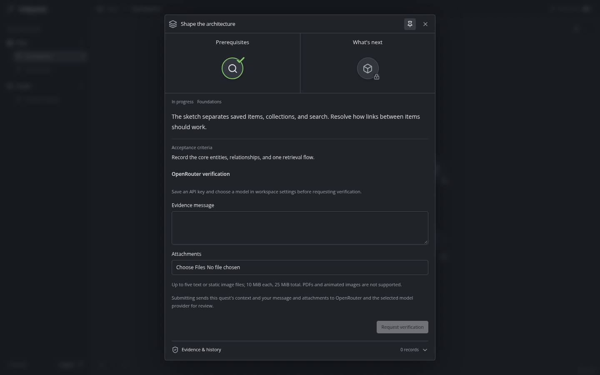
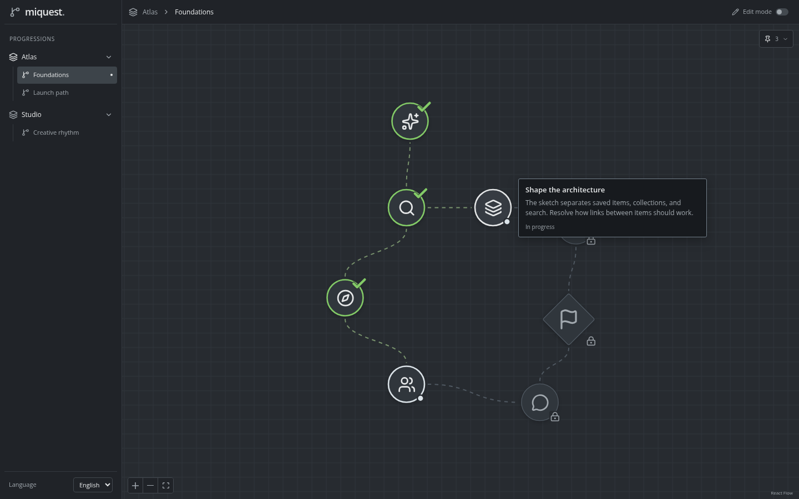

# MiQuest

MiQuest is a self-hosted, single-user quest graph for breaking down long-running projects and picking up where you left off. Organize quests into connected trees, track dependencies, and review evidence with OpenRouter or a manual override.


| Quest details | Quest tooltip |
| --- | --- |
|  |  |

## Using MiQuest

Create a project and organize its quests into trees. Connect quests to show which work depends on other work; a quest becomes available when its prerequisites are complete. A quest can appear in multiple trees while sharing its details, status, and verification history.

Turn on **Edit mode** to create and arrange quests, connect dependencies, and manage projects and trees. Tree edits are staged until you save them. Outside Edit mode, navigate the graph, open quests for their details, and pin quests you want to find quickly.

You can also use the [MiQuest project skill](skills/miquest-project/SKILL.md) with a coding agent to turn a project idea into an importable JSON graph. The skill includes a schema and example. In Edit mode, select **Import project**, choose the generated file, and review the summary before confirming; MiQuest creates an initial layout for the new project.

To complete a quest, submit a message or evidence for an OpenRouter review after configuring a key and model in Settings. You can also complete it with a reasoned manual override in Edit mode. Reviews and overrides are recorded in the quest's history; reopening a quest preserves that history. MiQuest stores projects and verification records locally in SQLite, with evidence stored alongside the database.

## Run with Docker

Build and start MiQuest with Docker Compose:

```sh
docker compose up --build -d
```

Open [http://127.0.0.1:8080](http://127.0.0.1:8080). The database is migrated automatically, and a named volume stores your data.

MiQuest has no built-in authentication. It listens on all interfaces, so restrict access with your firewall or private network. See the [deployment guide](docs/deployment.md) for private access and backup instructions.

## Development

Requires a POSIX system, GNU Make, Node.js 22.12+, npm, Python 3.12+, and [uv](https://docs.astral.sh/uv/). From the repository root:

```sh
make setup
make migrate
# Optional: load examples into an empty database
make prefill
make dev
```

Open [http://127.0.0.1:5173](http://127.0.0.1:5173). Press Ctrl+C to stop the development servers. Frontend changes reload automatically; restart `make dev` after backend changes.

See [backend development](backend/README.md) for backend setup and checks, and [the design](DESIGN.md) for product scope and architecture.
