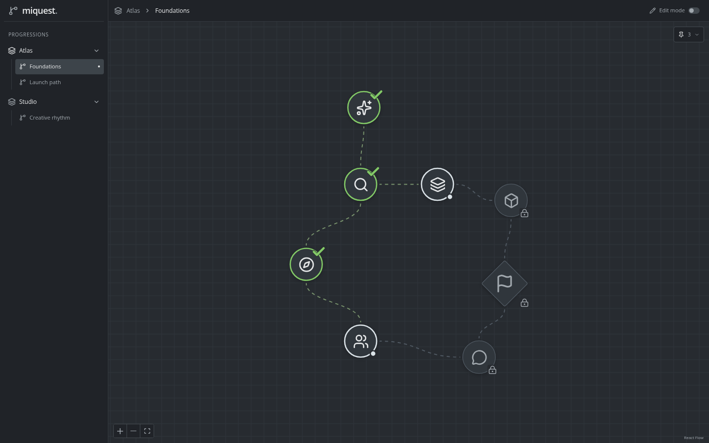
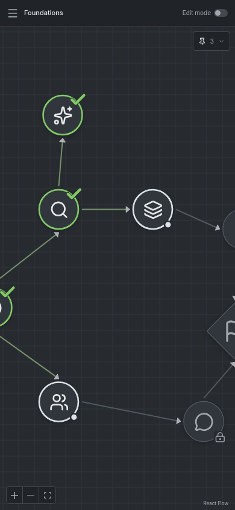
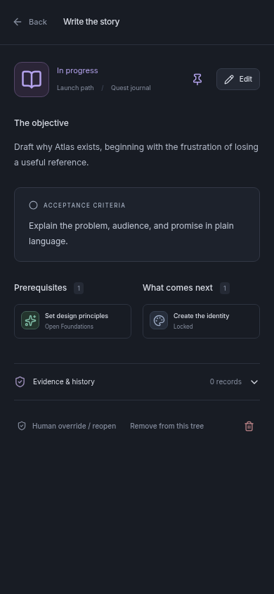

# MiQuest

A self-hosted, single-user quest graph for resuming and advancing long-running projects.

The example data contains two progressions, 18 quests, three trees, shared milestones, cross-tree links, pins, and verification history. Quests appear as 52px icon circles, with explicit milestones as 72px diamonds; title, description, and status appear on hover/focus. Changes are saved to the backend. Your last tree and each tree's canvas size and pan/zoom are restored after reload; Edit mode resets off and the pin panel starts closed.

## Run locally

Requires GNU Make, Node.js 22.12+, npm, Python 3.12+, and uv. From the repository root:

```sh
make setup
make migrate
# Optional: load examples into an empty database
make prefill
make dev
```

Open http://127.0.0.1:5173. The Vite development server proxies API requests to the backend on loopback. Press Ctrl+C to stop both servers. The frontend reloads as you edit; restart `make dev` after backend changes. The launcher requires a POSIX system. `make test` runs the launcher, backend, frontend, and browser tests; install Playwright Chromium first as described below. Set `DATABASE` to use a different database path, for example `make migrate DATABASE=/tmp/miquest.sqlite3` and `make dev DATABASE=/tmp/miquest.sqlite3`.

## Explore MiQuest

1. Explore **Atlas → Foundations**. Pan and zoom; Fit view is at the lower-left. Turn on Edit mode to drag quests, use Auto layout, or access editing controls. The switch resets off on reload.
2. Hover or focus a quest to see its title, description, and status. Long descriptions show “Click to read more.” Click, press Enter, or tap once to open the full journal; Back or Escape restores focus and the unblurred tree. The journal has prerequisite and What's next columns above description and acceptance criteria, with expandable history.
3. Open **A useful first version** on either Atlas tree: both appearances share one identity. Open the collapsed pins panel with its icon/count; pinned quests open on their home tree, and drag their grip or use the arrows to reorder them. Pin/unpin and both reorder methods work in normal mode.
4. On **Launch path**, follow the cross-tree prerequisite or inspect **Review the experience**: historical verification remains visible while a prerequisite is unsatisfied.
5. Turn on Edit mode to add a quest from the toolbar or canvas context menu, connect handles, or edit workspace settings. Click an edge to remove it; cycles are rejected.
6. In Edit mode, create/rename/delete progressions and trees. Last appearances cannot be removed; tree deletion requires moving otherwise orphaned quests. Global quest deletion requires confirmation.
7. In Edit mode, use the human override/reopen form with a reason and confirmation, then inspect its history. These decisions are recorded in the verification history.
8. At phone width, use the navigation drawer, collapsed pins, and full-screen journal. The saved canvas size and pan/zoom restore the centered view across desktop and phone; the graph stays pannable.

## Validate and capture screenshots

```sh
cd frontend
npm run lint
npm test
npm run build
npm exec playwright -- install chromium
npm run test:e2e
```

Browser tests automatically start the preview and capture five screenshots: [desktop](docs/screenshots/desktop.png), [tooltip](docs/screenshots/tooltip.png), [desktop journal](docs/screenshots/desktop-journal.png), [narrow](docs/screenshots/narrow.png), and [narrow journal](docs/screenshots/narrow-journal.png). They use an existing `/usr/bin/chromium` when available, otherwise Playwright's installed Chromium. Set `CHROME_PATH` to use another executable. GitHub Actions runs the same checks and uploads screenshots.

## Screenshots



| Quest tooltip | Quest journal |
| --- | --- |
|  |  |

| Narrow graph | Narrow journal |
| --- | --- |
|  |  |

## Backend

The Python backend provides a FastAPI REST API backed by SQLite, with Alembic migrations and verification history. There is no authentication, so keep the service on loopback or behind a trusted private network boundary. MCP and deployment are not included yet.

Install Python 3.12+ and [uv](https://docs.astral.sh/uv/). From the repository root, install dependencies, initialize the database, and start the API:

```sh
uv sync --project backend --extra dev
backend/.venv/bin/python -m miquest.runtime migrate --database ./data/miquest.sqlite3
# Optional: populate an empty database with example graphs
backend/.venv/bin/python -m miquest.runtime prefill --database ./data/miquest.sqlite3
backend/.venv/bin/python -m miquest.runtime serve --database ./data/miquest.sqlite3
```

The API listens on `127.0.0.1:8000`; readiness is available at `/readyz`. Run backend checks with:

```sh
cd backend
.venv/bin/ruff check .
.venv/bin/pyright
.venv/bin/pytest
```

See [backend development](backend/README.md) for details and [API/database contracts](docs/backend/README.md) for the OpenAPI spec and schema diagram.

The root stylesheet `frontend/src/index.css` holds semantic theme settings. Icons use stable names from one bundled Lucide registry; there are no uploads.

## Scope and next gate

[DESIGN.md](DESIGN.md) is authoritative. See [ROADMAP.md](ROADMAP.md), [PROGRESS.md](PROGRESS.md), and [AGENTS.md](AGENTS.md).

The frontend uses the backend REST API; see [backend setup and tests](backend/README.md) and the [API specification](docs/backend/openapi.json). MCP and deployment are not implemented.

Known tooling notes: the graph/UI production bundle triggers Vite's 500 kB advisory; the dependency audit reports seven moderate findings in the development-only TypeScript ESLint/minimatch chain. No forced dependency downgrade was applied.
